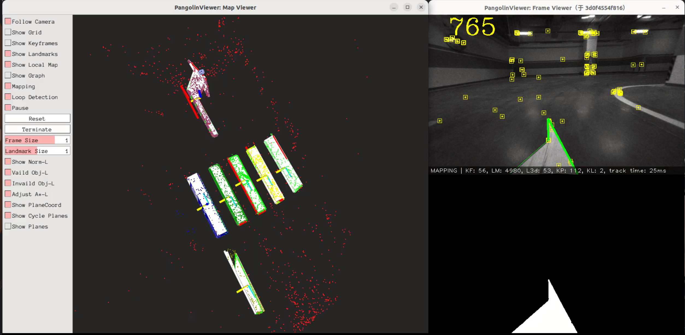

# VectoMark

**VectoMark: A Vectorized Road-Marking Reconstruction Method for Visual Mapping**

Official supporting implementation of the paper published in *IEEE Transactions on
Intelligent Transportation Systems (T-ITS)*.

[](https://ieeexplore.ieee.org/document/11683558)
[](https://doi.org/10.1109/TITS.2026.3726094)
[](LICENSE)

VectoMark is an RGB-D visual mapping system that reconstructs road markings as
**vectorized, structured 3D models** instead of dense point clouds. Given an RGB
sequence with depth and per-frame road-marking segmentation masks, it

1. extracts ORB points and LSD/LBD lines online,
2. assigns lines to planar road-marking objects (each object is one connected
   region in the segmentation mask),
3. closes each marking outline by solving an **ordered endpoint traversal**
   (greedy + 2-opt) and snapping endpoints to **line-line intersections**,
4. produces vectorized attributes per marking: closed polygon vertices,
   parallel/orthogonal line pairs, and line-level constraints, and
5. jointly optimizes points, lines, and planes in local/global BA.

The whole reconstruction is visualized live in Pangolin (green polygon = closed
marking), and the camera trajectory is exported in TUM format.

> **Only the RGB-D pipeline is shipped here.** Monocular/stereo front-ends from the
> upstream research code base have been removed; the executable refuses to run
> with any camera setup other than `RGBD`.

---

## 1. Experiments Videos (Click to jump)

YouTube [Here (default)](https://www.youtube.com/watch?v=5Isd0tu_a6w)

Bilibili [Here](https://www.bilibili.com/video/BV1471vBoEXb/?vd_source=a422a042a62840fe268651c9dbc91561)

[](https://www.youtube.com/watch?v=5Isd0tu_a6w)

---

## 2. Repository structure

```
VectoMark/
├── CMakeLists.txt                  # top-level build (PLPSLAM + viewer + one executable)
├── cmake/                          # FindCXSparse / FindEigen3 / FindSuiteSparse / FindYamlCpp
├── 3rd/                            # header-only deps: json, popl, spdlog
├── orb_vocab/orb_vocab.dbow2        # ORB vocabulary for the DBoW2 loop detector
├── example/
│   ├── run_slam_plane_vector.cc     # the only executable: RGB-D + plane + vectorization
│   ├── util/planeSeg_util.{h,cc}    # sequence reader (rgb/depth/mask + timestamps)
│   └── tum_rgbd/TUM_RGBD_rgbd_1_exp_li.yaml   # example configuration
├── src/
│   ├── PLPSLAM/                    # SLAM library
│   │   ├── system.cc, tracking_module.cc, mapping_module.cc
│   │   ├── planar_mapping_module.cc  # 2D mask -> 3D planar objects
│   │   ├── plane_process.cc          # outlier filter, projection, LDBSCAN + loop closing
│   │   ├── ldbscan.cc                # line clustering
│   │   ├── loop_arrow.cc             # vectorization: endpoint ordering, intersections, cycles
│   │   └── planar_mapping_parameters.yaml   # runtime parameters (loaded from CWD!)
│   └── pangolin_viewer/            # live visualization
└── run_vectoMark.sh                # example launcher
```

`src/PLPSLAM/planar_mapping_parameters.yaml` is loaded with a **hard-coded relative
path** `./src/PLPSLAM/planar_mapping_parameters.yaml`, so the binary must be started
from the repository root.

---

## 3. Environment setup (without Docker)

### 3.1 Tested platform

| Item | Value |
|---|---|
| OS | Ubuntu 22.04 (x86-64) |
| Compiler | GCC 11, C++17 |
| CMake | >= 3.16 (project minimum 3.8) |
| OpenCV | 4.5.4 (Ubuntu package) |
| Eigen | 3.4 (Ubuntu package) |
| g2o | built from `master` with `-DEIGEN_DONT_ALIGN_STATICALLY` |
| DBoW2 | `shinsumicco/DBoW2` fork (needs `loadFromBinaryFile`) |
| Pangolin | built from source (needs GLEW) |
| GPU | not required (OpenGL/X11 is required only for the viewer) |

### 3.2 Install system packages

```bash
sudo apt-get update
sudo apt-get install -y \
  build-essential cmake git pkg-config ccache \
  libeigen3-dev libopencv-dev libyaml-cpp-dev \
  libsuitesparse-dev libcxsparse3 \
  libglew-dev libglfw3-dev libgl1-mesa-dev libglu1-mesa-dev libepoxy-dev \
  libx11-dev libxi-dev libxmu-dev libxrandr-dev libxinerama-dev libxcursor-dev
```

`libcxsparse3` / `libsuitesparse-dev` are needed by the g2o sparse solvers.

### 3.3 Pangolin (viewer)

```bash
git clone --depth 1 https://github.com/stevenlovegrove/Pangolin.git
cmake -S Pangolin -B Pangolin/build \
  -DCMAKE_BUILD_TYPE=Release \
  -DCMAKE_INSTALL_PREFIX=/usr/local \
  -DBUILD_PANGOLIN_PYTHON=OFF \
  -DBUILD_EXAMPLES=OFF
cmake --build Pangolin/build -j"$(nproc)"
sudo cmake --install Pangolin/build
```

### 3.4 g2o (must use `EIGEN_DONT_ALIGN_STATICALLY`)

The project is compiled with `-DEIGEN_DONT_ALIGN_STATICALLY` to avoid Eigen
alignment asserts inside g2o. **g2o must be built with the same macro**, otherwise
you will hit `data is not aligned` in `BaseFixedSizedEdge::linearizeOplus`.

```bash
git clone --depth 1 https://github.com/RainerKuemmerle/g2o.git
cmake -S g2o -B g2o/build \
  -DCMAKE_BUILD_TYPE=Release \
  -DCMAKE_INSTALL_PREFIX=/usr/local \
  -DBUILD_SHARED_LIBS=ON \
  -DG2O_BUILD_APPS=OFF \
  -DG2O_BUILD_EXAMPLES=OFF \
  -DG2O_USE_OPENGL=OFF \
  -DG2O_USE_CSPARSE=ON \
  -DCMAKE_CXX_FLAGS="-DEIGEN_DONT_ALIGN_STATICALLY"
cmake --build g2o/build -j"$(nproc)"
sudo cmake --install g2o/build
```

### 3.5 DBoW2

The original `DBoW2` does not provide `loadFromBinaryFile`, which this project uses
to load `orb_vocab.dbow2`. Build the fork:

```bash
git clone --depth 1 https://github.com/shinsumicco/DBoW2.git
cmake -S DBoW2 -B DBoW2/build \
  -DCMAKE_BUILD_TYPE=Release \
  -DCMAKE_INSTALL_PREFIX=/usr/local \
  -DBUILD_SHARED_LIBS=ON
cmake --build DBoW2/build -j"$(nproc)"
sudo cmake --install DBoW2/build
```

Then provide the CMake package file used by `find_package(DBoW2)`:

```bash
sudo mkdir -p /usr/local/lib/cmake/DBoW2
sudo tee /usr/local/lib/cmake/DBoW2/DBoW2Config.cmake >/dev/null <<'EOF'
include(CMakeFindDependencyMacro)
set(DBoW2_INCLUDE_DIRS "/usr/local/include")
if(EXISTS "/usr/local/lib/libDBoW2.so")
  set(DBoW2_LIBS "/usr/local/lib/libDBoW2.so")
elseif(EXISTS "/usr/local/lib/libDBoW2.a")
  set(DBoW2_LIBS "/usr/local/lib/libDBoW2.a")
else()
  set(DBoW2_LIBS "DBoW2")
endif()
EOF
```

### 3.6 CXSparse header path and shared libraries

`cmake/FindCXSparse.cmake` looks for `cs.h` under `/usr/include`; Ubuntu ships it in
`/usr/include/suitesparse`:

```bash
sudo ln -sf /usr/include/suitesparse/cs.h /usr/include/cs.h

echo "/usr/local/lib" | sudo tee /etc/ld.so.conf.d/usr-local-lib.conf
sudo ldconfig
# if you prefer not to touch ld.so.conf:
# export LD_LIBRARY_PATH=/usr/local/lib:$LD_LIBRARY_PATH
```

### 3.7 Build

```bash
cd VectoMark
cmake -S . -B build -DCMAKE_BUILD_TYPE=Release -DUSE_OPENMP=ON
cmake --build build -j"$(nproc)"
```

The executable is `build/run_slam_plane_vector`.

Common build options:

| Option | Default | Meaning |
|---|---|---|
| `CMAKE_BUILD_TYPE` | `Release` | `Release` / `Debug` / `RelWithDebInfo` |
| `USE_PANGOLIN_VIEWER` | `ON` | live visualization (required by the executable) |
| `USE_OPENMP` | `OFF` | parallel distance matrix in the endpoint-ordering solver |
| `USE_SSE_ORB` | `OFF` | `-msse3` for ORB extraction |
| `BUILD_WITH_MARCH_NATIVE` | `OFF` | `-march=native` (do not use for redistributable binaries) |
| `USE_CCACHE` | `ON` | use ccache if available |

---

## 4. Dataset preparation

The system consumes a **TUM-RGBD-like directory** plus per-frame **road-marking
instance masks**. Every sequence needs three synchronized streams (RGB, depth,
mask) and one timestamp index file per stream.

### 4.1 Directory layout

```
<sequence_dir>/
├── rgb.txt
├── rgb/          # e.g. 1341847980.722988.png
├── depth.txt
├── depth/        # e.g. 1341847980.722988.png
├── mask.txt
└── mask/         # e.g. 1341847980.722988.png
```

Example: `-d /path/to/sequences/b2_s3`

### 4.2 Timestamp files (`rgb.txt`, `depth.txt`, `mask.txt`)

TUM format: **exactly three header lines**, then one entry per line
`timestamp relative_path`.

```
# color images
# file: 'sequence.bag'
# timestamp filename
1341847980.722988 rgb/1341847980.722988.png
1341847981.051035 rgb/1341847981.051035.png
...
```

Rules enforced by the code:

- The first three lines are skipped unconditionally — they must exist.
- `timestamp` is in seconds (double), `relative_path` is resolved against the
  sequence directory.
- **`mask.txt` must list the same number of entries, in the same order, as
  `rgb.txt`.** Masks are paired with RGB frames by line index, not by timestamp.
- Depth frames are associated to each RGB frame by nearest timestamp; pairs further
  apart than **0.1 s** are dropped (constant `min_timediff_thr` in
  `example/util/planeSeg_util.cc`).

### 4.3 Image requirements

| Stream | Format | Notes |
|---|---|---|
| `rgb/` | 8-bit PNG/JPG | Must have the same size as the mask. Set `Camera.color_order` to `Gray` for grayscale input, `BGR` / `RGB` for color input (it is converted to grayscale internally). |
| `depth/` | 16-bit PNG | Depth in **millimetres** (divide factor set by `depthmap_factor`, default `1000.0`). Values `0` are treated as invalid. |
| `mask/` | **8-bit, single-channel PNG** | `0` = background (not a road marking). Every road marking instance must be a **distinct non-zero value / connected region**. Regions smaller than `Arrow.min_area` (default `700` px) are ignored. |

Notes on the mask:

- The mask is used as an *instance* map: connected components are labelled
  internally, and each component becomes one 2D planar object; the labels are
  re-computed per frame, so the same marking may get a different value in the next
  frame (cross-frame association is done by reprojection, not by label).
- The mask must be single-channel 8-bit: it is passed to
  `cv::connectedComponentsWithStats`. A 3-channel colour mask raises an OpenCV
  assertion. (Colour instance masks belong to the non-vectorized upstream pipeline,
  which is not included here.)
- The mask and RGB images must have identical `rows`/`cols` (asserted).
- Masks can be produced by any instance/semantic segmentation model or by manual
  annotation, as long as each marking is one region with a unique non-zero value.

### 4.4 Camera configuration

Copy `example/tum_rgbd/TUM_RGBD_rgbd_1_exp_li.yaml` and adapt the camera block to
your sensor. The fields that must match your data:

```yaml
Camera.name: "My-Camera"
Camera.setup: "RGBD"          # must stay RGBD
Camera.model: "perspective"

Camera.fx: 2.3375081946538381e+02
Camera.fy: 2.3375081946538381e+02
Camera.cx: 3.1310080819654763e+02
Camera.cy: 2.0635785988047385e+02

Camera.k1: 0.0                # radial-tangential distortion
Camera.k2: 0.0
Camera.p1: 0.0
Camera.p2: 0.0
Camera.k3: 0.0

Camera.fps: 50.0
Camera.cols: 640
Camera.rows: 400
Camera.color_order: "Gray"    # Gray / RGB / BGR

depth_threshold: 20.0         # max valid depth [m]
depthmap_factor: 1000.0       # depth_png_value / depthmap_factor = metres
```

`--frame-skip` can be used if your sequence is far denser than the nominal FPS.

### 4.5 Key road-marking (vectorization) parameters

All parameters are read from the `-c` YAML at start-up; `Arrow.*` refers to the
road-marking (planar object) pipeline.

| Parameter | Meaning |
|---|---|
| `Arrow.min_area` | minimum mask region area in pixels |
| `Arrow.use_plane_line_depth_threshold`, `Arrow.plane_line_depth_threshold` | depth consistency filter for line segments inside a marking: `[max endpoint depth difference, max depth when parallel to the camera, max depth otherwise]` (metres) |
| `Arrow.line_angle_outlier_thr`, `Arrow.line_length_outlier_thr` | outlier thresholds for marking lines (deg, relative length) |
| `Arrow.use_slope_angle`, `Arrow.slope_angle_thr`, `Arrow.angle_thr`, `Arrow.length_thr`, `Arrow.arrow_angle_thr`, `Arrow.arrow_length_thr` | 2D line matching constraints during triangulation |
| `Arrow.point_plane_center_thr` | max distance between a landmark and the plane centroid for 2D-3D plane association |
| `Arrow.point_plane_opt`, `Arrow.line_plane_opt`, `Arrow.plane_weight`, `Arrow.line_gamma` | point/line-to-plane constraints in local/global BA |
| `Arrow.use_arrow_endpoints_trimming` | endpoint trimming for map visualization |
| `Arrow.not_clean_line`, `Arrow.not_clean_keyframe` | keep marking lines/keyframes when cleaning the local map (recommended `true`) |

`src/PLPSLAM/planar_mapping_parameters.yaml` (loaded from the working directory)
additionally enables line tracking: `Threshold.use_line_tracking: true`. Without it
the line/vectorization pipeline is not executed.

---

## 5. Running

Always start from the repository root:

```bash
./build/run_slam_plane_vector \
  -v ./orb_vocab/orb_vocab.dbow2 \
  -d /path/to/sequences/b2_s3 \
  -c ./example/tum_rgbd/TUM_RGBD_rgbd_1_exp_li.yaml \
  --no-sleep \
  --eval-log \
  --auto-end
```

or edit the dataset/config paths in `run_vectoMark.sh` and run:

```bash
./run_vectoMark.sh
```

### 5.1 Options

| Option | Description |
|---|---|
| `-v, --vocab` | ORB vocabulary (`orb_vocab/orb_vocab.dbow2`) |
| `-d, --data-dir` | sequence directory (see Section 4.1) |
| `-c, --config` | camera + parameter YAML |
| `--frame-skip N` | process every N-th frame (default 1) |
| `--no-sleep` | do not wait for the next frame in real time |
| `--eval-log` | dump the frame trajectory |
| `--auto-end` | close the viewer when the sequence is finished |
| `--auto-term` | terminate the viewer automatically |
| `-p, --map-db FILE` | save the map database after SLAM |
| `--debug` | verbose logging |

### 5.2 Output

```
vectoMark4/<sequence_name>_frame_trajectory.txt
```

TUM format, one line per frame:

```
timestamp tx ty tz qx qy qz qw
```

`<sequence_name>` is the last path component of `-d`. The directory is created in
the current working directory. Tracking time statistics are printed at the end.

### 5.3 Viewer

Pangolin window menu (right panel) toggles:

| Menu entry | Content |
|---|---|
| `Show Keyframes`, `Show Landmarks`, `Show Local Map`, `Show Graph` | standard SLAM entities |
| `Norm-L` | non-marking 3D lines |
| `Vaild Obj-L` / `Invaild Obj-L` | marking lines that are (not) selected for optimization |
| `Adjust A*-L` | marking lines updated by the loop-closing step |
| `Show Cycle Planes` | **closed vectorized markings** (polygon built from the ordered cycle) |
| `Show PlaneCoord` | plane coordinate frames |

A headless machine needs an X server: use `ssh -X`, a VNC session, or
`xvfb-run ./build/run_slam_plane_vector ...`.

---

## 6. Troubleshooting

**`data is not aligned ... BaseFixedSizedEdge::linearizeOplus` (Eigen assert)**
g2o was built without `-DEIGEN_DONT_ALIGN_STATICALLY`. Rebuild g2o as in §3.4 and
reinstall.

**Undefined reference to `DBoW2::Vocabulary::loadFromBinaryFile`**
You installed the original DBoW2. Use `shinsumicco/DBoW2` (§3.5).

**`cv::Exception ... connectedComponentsWithStats ... image.type() == CV_8UC1`**
Your mask is a colour image. Export single-channel 8-bit instance masks (§4.3).

**`Could not load a timestamp file from .../mask.txt`**
The sequence directory lacks `mask.txt` (or `rgb.txt` / `depth.txt`).

**`YAML::TypedBadConversion` / `InvalidNode` at start-up or during optimization**
A key required by the code is missing from the YAML. Known case: `global_bundle_adjuster`
reads `Arrow.trimming_dist_thr2` when a loop closure trims marking-line endpoints;
add it (e.g. `Arrow.trimming_dist_thr2: 0.3`) if you enable loop closure with
marking lines.

**Viewer is frozen / black window on a server**
No OpenGL display available — forward X11 or use `xvfb-run`.

**`error while loading shared libraries: libPLPSLAM.so`**
`sudo ldconfig` after installing dependencies into `/usr/local`, or set
`LD_LIBRARY_PATH=/usr/local/lib`.

---

## 7. Citation

If you use this code or the vectorized road-marking representation in your
research, please cite:

```bibtex
@ARTICLE{11683558,
  author={Li, Peitong and Hu, Hang and Dong, Yanchao and He, Bin},
  journal={IEEE Transactions on Intelligent Transportation Systems},
  title={VectoMark: A Vectorized Road-Marking Reconstruction Method for Visual Mapping},
  year={2026},
  volume={},
  number={},
  pages={1-12},
  keywords={Simultaneous localization and mapping;Roads;Planing;Modeling;Visualization;Sequential analysis;Sequences;Location awareness;Distance measurement;Joining processes;Vectorized road-marking reconstruction;visual mapping;planar object;semantic mapping;structured map representation},
  doi={10.1109/TITS.2026.3726094}}
```

Paper: <https://ieeexplore.ieee.org/document/11683558>

---

## 8. Acknowledgements

This implementation builds on the excellent open-source projects below; please
respect their licenses:

- **Structure PLP-SLAM** (Fangwen Shu, DFKI) — the point/plane SLAM framework this
  code base is derived from.
- **ORB-SLAM2 / openvslam** — ORB tracking, map and optimization structures.
- **DBoW2** — place recognition.
- **g2o** — graph optimization.
- **Pangolin** — visualization.
- **spdlog**, **nlohmann/json**, **popl** — utilities.

## 9. License

GNU General Public License v3.0, inherited from Structure PLP-SLAM. See
[LICENSE](LICENSE).

---

## 10. 中文速览

```bash
# 1) 依赖
sudo apt install -y build-essential cmake git pkg-config libeigen3-dev libopencv-dev \
  libyaml-cpp-dev libsuitesparse-dev libcxsparse3 libglew-dev libglfw3-dev \
  libgl1-mesa-dev libglu1-mesa-dev libepoxy-dev libx11-dev libxi-dev libxmu-dev \
  libxrandr-dev libxinerama-dev libxcursor-dev

# 2) 源码安装 Pangolin / g2o(带 -DEIGEN_DONT_ALIGN_STATICALLY) / DBoW2(shinsumicco)
#    详见第 3 章，安装后执行：
sudo ln -sf /usr/include/suitesparse/cs.h /usr/include/cs.h && sudo ldconfig

# 3) 编译
cmake -S . -B build -DCMAKE_BUILD_TYPE=Release -DUSE_OPENMP=ON
cmake --build build -j$(nproc)

# 4) 数据：<seq>/rgb.txt rgb/ depth.txt depth/ mask.txt mask/
#    mask 必须是单通道 8bit，0=背景，每个路面标记(平面对象)一个独立的非零连通域
#    depth 为 16bit，单位 mm，缩放系数由 depthmap_factor 控制

# 5) 运行（必须在仓库根目录，planar_mapping_parameters.yaml 用的是相对路径）
./build/run_slam_plane_vector -v ./orb_vocab/orb_vocab.dbow2 \
  -d /path/to/<seq> -c ./example/tum_rgbd/TUM_RGBD_rgbd_1_exp_li.yaml \
  --no-sleep --eval-log --auto-end

# 输出：vectoMark4/<seq>_frame_trajectory.txt （TUM 格式：timestamp tx ty tz qx qy qz qw）
```
